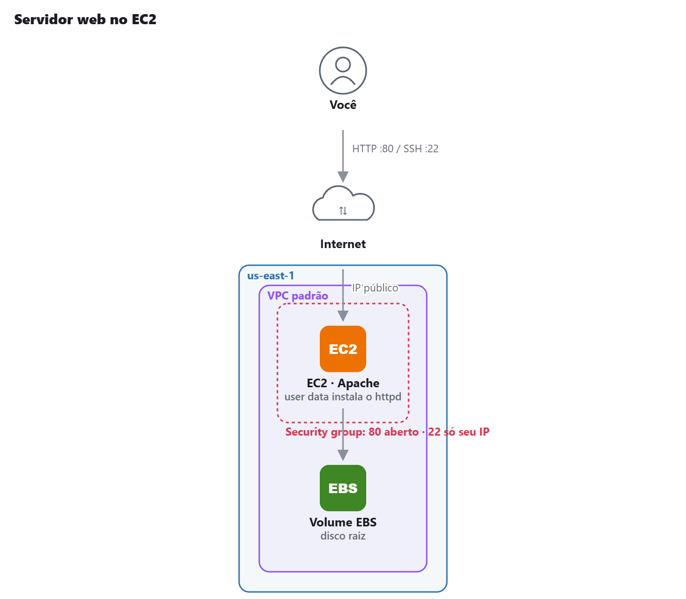
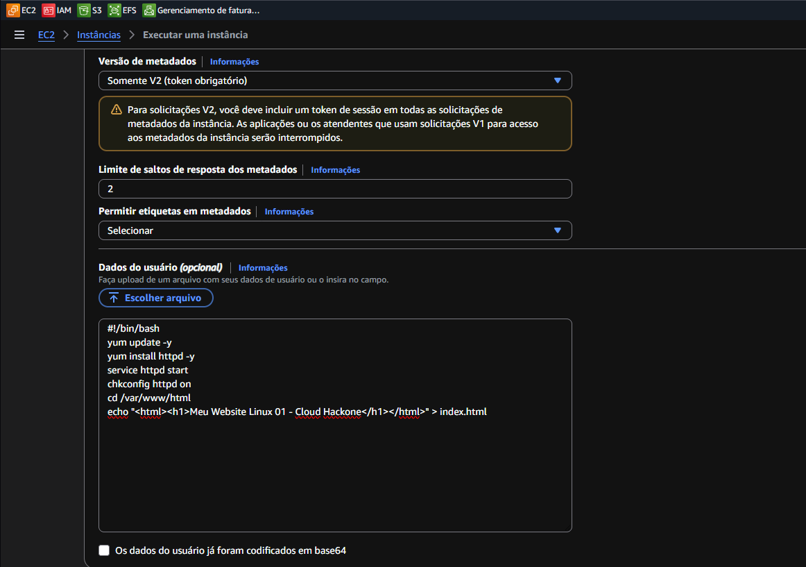

# AWS Lab 02 — Servidor Web no EC2

Laboratório 02 da minha trilha de estudos para a **AWS Certified Cloud Practitioner (CLF-C02)**.

## Objetivo

Provisionar uma instância Amazon EC2, configurar um Security Group e utilizar User Data para automatizar a instalação de um servidor web.

## Arquitetura

## O que eu fiz

- [x] Iniciei a criação de uma instância EC2.
- [x] Configurei o Security Group para permitir tráfego HTTP na porta 80.
- [x] Configurei o User Data para instalar e iniciar o servidor web.
- [x] Iniciei a instância e acessei o site pelo navegador.
- [x] Testei as regras de firewall.
- [x] Documentei o laboratório.

## Prints

### Instância EC2 USER DATA

### Security Group

### Servidor Web funcionando

## O que aprendi

- O Amazon EC2 permite provisionar servidores virtuais na nuvem.
- Security Groups (SG) funcionam como firewalls virtuais Stateful, ele bloqueia entrada, mas automaticamente libera saída
- Network ACL (NACL) que é Stateless, bloqueia entrada e saída
- O User Data permite automatizar tarefas de inicialização.
- A porta TCP 80 é utilizada para tráfego HTTP.

## Domínio da prova

Tecnologia — Computação | Segurança

## Limpeza — prevenção de custos

- [x] Terminei a instância EC2 utilizando a opção Terminate.
- [x] Excluí o Security Group, caso não esteja sendo utilizado.
- [x] Verifiquei se existem volumes EBS não utilizados.
- [x] Verifiquei se existem Elastic IPs alocados.
